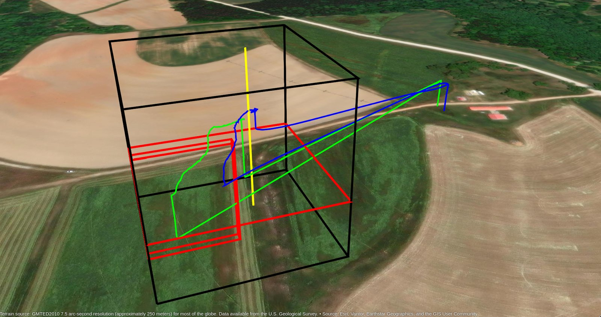
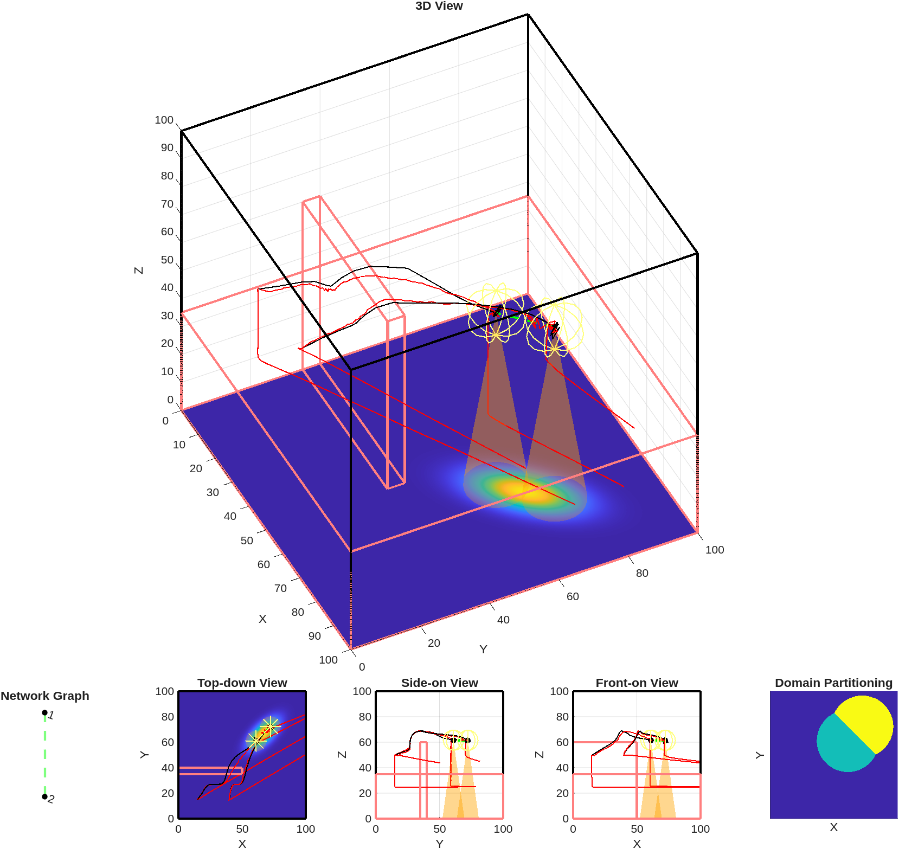

# miSim
*Multi-agent Interconnectivity Simulation*


<sub>Two UAVs flying a miSim guidance scenario on the [AERPAW](https://aerpaw.org) testbed. Green and blue are the recorded GPS tracks, including the transits to and from the launch site. The black box is the guidance domain, red outlines are the virtual wall obstacle and minimum-altitude floor, and yellow marks the sensing objective.</sub>

miSim is a MATLAB simulator for deploying a team of UAVs to cover a ground region, either by sensing it or by providing it with wireless service. Each UAV moves to improve the coverage of its own share of the region. A control barrier function (CBF) safety filter adjusts that motion so the UAVs:

- stay inside the operating domain and above a minimum altitude,
- avoid obstacles and each other, and
- keep the communication links that hold the team together as one network.

The same guidance code is compiled with MATLAB Coder and flown on real UAVs at AERPAW.

## Thesis

This repository is the software for:

> Kevin Dee, *Dynamic Deployment of UAV Networks for Wireless Communication and Sensing*, M.S. thesis, University of California, Irvine, 2026 (draft).

| Thesis chapter | Code |
|---|---|
| 2. Problem statement: sensing model | [`@sigmoidSensor`](@sigmoidSensor) |
| 2. Problem statement: service (SINR) model | [`@rfSensor`](@rfSensor) |
| 2. Problem statement: UAV link model | [`@miSim/sinrLink.m`](@miSim/sinrLink.m), [`@miSim/updateAdjacency.m`](@miSim/updateAdjacency.m) |
| 3. Unconstrained solution: tessellation | [`@agent/partition.m`](@agent/partition.m) |
| 3. Unconstrained solution: nominal control | [`@agent/run.m`](@agent/run.m) |
| 4. Constrained solution: CBF constraints and enforcement | [`@miSim/constrainMotion.m`](@miSim/constrainMotion.m) |
| 4. Constrained solution: network topology and data routing | [`@miSim/lesserNeighbor.m`](@miSim/lesserNeighbor.m), [`@miSim/lesserSinkNeighbor.m`](@miSim/lesserSinkNeighbor.m) |
| 5. Simulation results | [`test/`](test), [`test_thesis_plots.m`](test_thesis_plots.m) |
| 6. Experimental validation | [`aerpaw/`](aerpaw) |

## What it does

Each simulation step runs four stages:

1. **Partition.** Every point on the ground is assigned to the UAV that senses or serves it best ([`@agent/partition.m`](@agent/partition.m)).
2. **Nominal control.** Each UAV takes a gradient-ascent step that improves coverage of its own partition ([`@agent/run.m`](@agent/run.m)).
3. **Topology.** The simulator chooses which communication links must be kept so that the team stays connected.
4. **Safety filter.** A quadratic program makes the smallest change to the nominal motion that satisfies every constraint: domain, minimum altitude, obstacles, collisions and communication ([`@miSim/constrainMotion.m`](@miSim/constrainMotion.m)).

Coverage objectives:
- **Sensing:** a sigmoid sensor model whose performance depends on distance and tilt angle.
- **Wireless service:** the SINR received on the ground, with path loss, antenna patterns and interference from the other UAVs.

Communication models:
- **Fixed range:** two UAVs can communicate if they are within range of each other.
- **SINR:** a link exists only if the SINR clears a threshold in both directions, with every other UAV counted as interference.

Which links are kept is chosen by one of three rules:
- **Lesser Neighbor (default).**
- **Fixed:** the links that exist at the start are kept for the whole run.
- **CALSN (Capacity-Aware Lesser Sink Neighbor).** It sends every UAV's data toward two base stations and also produces a routing table. CALSN is MATLAB-only; the compiled AERPAW controller uses Lesser Neighbor.

## Repository layout

| Path | Contents |
|---|---|
| [`@miSim`](@miSim) | Simulation class: setup, main loop, topology, CBF safety filter, plotting |
| [`@agent`](@agent) | UAV class: partitioning, nominal control, plotting |
| [`@sigmoidSensor`](@sigmoidSensor), [`@rfSensor`](@rfSensor) | Sensing and wireless-service performance models |
| [`@sensingObjective`](@sensingObjective) | Ground objective (importance density over the region) |
| [`geometries`](geometries) | Geometry classes for the domain, obstacles, collision volumes and sensor footprints |
| [`util`](util) | Objective functions, scenario CSV reader, validators, figure export |
| [`test`](test) | MATLAB unit tests and demonstration scenarios |
| [`aerpaw`](aerpaw) | Testbed deployment: compiled controller, UAV client, radio, scenarios, log analysis |

## Getting started

Requirements:
- MATLAB (developed on R2025a; requirements checked on R2026a)
- Optimization Toolbox (`quadprog` for the safety filter)
- Statistics and Machine Learning Toolbox (`mvnpdf` for Gaussian objectives)

Open the project and run a demonstration scenario, in which four UAVs converge on a sensing objective while their communication links re-route:

```matlab
openProject("miSim.prj");
results = runtests("test/test_miSim.m", "ProcedureName", "test_routing_topology_convergence_demo");
```

[`test/test_miSim.m`](test/test_miSim.m) covers collision and obstacle avoidance, the fixed-range and SINR communication constraints, the network topology rules, and randomized end-to-end runs. Plotting and video writing are switched on by default by the `makePlots` and `makeVideo` properties at the top of the file. Turning them off makes runs much faster.

## AERPAW deployment

The guidance algorithm runs on real UAVs at [AERPAW](https://aerpaw.org) (Aerial Experimentation and Research Platform for Advanced Wireless):

- **Controller.** [`aerpaw/guidance_step.m`](aerpaw/guidance_step.m) wraps miSim for one guidance step. MATLAB Coder compiles it, together with [`aerpaw/controller.m`](aerpaw/controller.m), into a C++ controller ([`aerpaw/impl`](aerpaw/impl), built by [`aerpaw/compile.sh`](aerpaw/compile.sh)).
- **UAV clients.** The controller talks over TCP to one Python client per UAV ([`aerpaw/client/uav_runner.py`](aerpaw/client/uav_runner.py), built on aerpawlib). Each guidance step, the controller receives the UAVs' GPS positions and sends back their next waypoints.
- **Scenarios.** Experiments are defined in [`aerpaw/config/`](aerpaw/config): `scenario_two_around_wall.csv`, `scenario_columns.csv`, `scenario_walls.csv` and `scenario_lock.csv`. The active one is `scenario.csv`.
- **Radio.** [`aerpaw/radio/`](aerpaw/radio) contains a GNU Radio channel sounder that measures the link between the UAVs during flight.
- **Analysis.** [`aerpaw/results/`](aerpaw/results) reads the GPS, radio and controller logs and replays a flight against the simulation.


<sub>The two-around-wall flight replayed in miSim. Black is the simulated trajectory and red is the recorded GPS track, including the transits to and from the launch site. The lower panels show the network graph, three orthogonal views and the final domain partition.</sub>

Deployment requirements, in addition to the simulation requirements above:
- MATLAB Coder and a C++ compiler, to build the controller
- Python 3 with aerpawlib and PyYAML, for the UAV clients
- GNU Radio with UHD, for the channel sounder
- For the 3-D globe plots of flight logs ([`aerpaw/results/plotGpsLogs.m`](aerpaw/results/plotGpsLogs.m)): Mapping Toolbox, plus one of UAV Toolbox, Navigation Toolbox, or Sensor Fusion and Tracking Toolbox (any of them provides `enu2lla`/`lla2enu`)

## Citation

```bibtex
@mastersthesis{dee2026thesis,
  author = {Kevin Dee},
  title  = {Dynamic Deployment of {UAV} Networks for Wireless Communication and Sensing},
  school = {University of California, Irvine},
  year   = {2026},
  note   = {Draft}
}

@misc{miSim,
  author       = {Kevin Dee},
  title        = {{miSim}: A Multi-{UAV} Coverage and Connectivity Simulator},
  year         = {2026},
  howpublished = {\url{https://github.com/krdee1/miSim}},
  note         = {MATLAB software}
}
```
